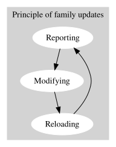

#############################################
The Chain
#############################################

Summary
=======

The chain consists of a number of main workflows aimed at en mass family updates:

- Reporting - of family properties :  

    - `REPORTING <../../_00_ReportFamilyData/_docs/HowTo_ReportFamilies.rst>`_
    - `SAVING MISSING FAMILIES <../../_00_X_SavingMissingFamilies/_docs/HowTo_SaveOutMissingFamilies.rst>`_

- Changing - Specific families with specific actions : 

    - `RENAMING <../../_01_X_RenameFamilies/_docs/HowTo_RenameFamilies.rst>`_
    - `CHANGE FAMILY CATEGORY <../../_01_Y_ChangeFamilyCategory/_docs/HowTo_ChangeFamilyCategory.rst>`_
    - `CHANGE FAMILY SUB CATEGORIES <../../_01_Z_ChangeFamilySubCategory/_docs/HowTo_ChangeFamilySubCategory.rst>`_

- Changing - All families with a default set of actions : 

    - `MODIFY DEFAULT <../../_01_ModifyFamilyChange/_docs/HowTo_ModifyFamiliesDefault.rst>`_

- Reloading - nested families into host families : HowTo_ReloadFamilies.rst

    - `RELOADING <../../_02_ModifyFamilyLibraryReloadAdvanced/_docs/HowTo_ReloadFamilies.rst>`_

Putting it all together
=======================

The PowerShell script theChain.ps1 in __A0_TheChain runs the flows switched on, in this order, passing each flow's results on to the next:

#. InitialReport : report on all families in the library
#. FollowUpReport : report again on the families the last report could not process
#. SaveMissingFamilies : save families missing from the library out of their host families
#. ModifyDefault : modify families with the default set of actions
#. RenameFamilies : rename families and the nested families in them, followed by a follow up report
#. ChangeFamilyCategories : change family categories, followed by a follow up report
#. RenameSubCategories : rename sub categories, followed by a follow up report
#. ReloadFamilies : reload the changed families into their host families, followed by a follow up report on the reloaded families
   (or, with FullReportAfterReload, a full report and a follow up report)

.. code-block:: powershell

    # initial report only (also what runs without any switch)
    powershell -ExecutionPolicy Bypass -File theChain.ps1 -InitialReport

    # rename families, change categories, and reload everything that changed
    powershell -ExecutionPolicy Bypass -File theChain.ps1 -RenameFamilies -ChangeFamilyCategories -ReloadFamilies

Get-Help .\theChain.ps1 -Detailed lists all switches.

Each flow can also be run on its own with the start script in its _Script folder, e.g. _00_ReportFamilyData\_Script\startReportFamilyData.ps1.

Run setupUsers.ps1 once before the first run (see `SET UP <setup.rst>`_).

Files passed between flows
--------------------------

Before a flow runs, theChain.ps1 copies its input files into the flow's _Users\YOURUSERNAME\_Input folder:

* the report's _Analysis\_Current folder provides:

    * FamilyBaseDataCombinedReport.csv : to the rename and reload flows
    * FamilyCategoriesCombinedReport.csv : to the change family category and change sub category flows
    * HostsMissingFamilies.csv : to the save missing families flow
    * SecondProcessFamilies.csv : the families listed in it are reported on in a follow up report

* the changed families lists (_Output\ChangedFilesTaskList.csv) of the modify, rename, change category and change sub category flows
  run in the same run are combined into the reload flow's _Input\ChangedFilesTaskList.csv, so every family changed in the run is reloaded.
  If none of them ran, the reload uses the changed families list already in its _Input folder.

* a follow up report runs on the families in the changed families list of the flow before it, and its results are merged into the
  current reports.

A flow's changed families list from a previous run is deleted before the flow runs, so it can't be passed on as if it were new.

If a flow fails, The Chain stops, since the flows after it would work on incomplete data. A flow with nothing to process,
for example without any change directives, is skipped and The Chain carries on.

Logs
----

* The Chain: __A0_TheChain\logs\YOURUSERNAME_TheChain_YYYY-MM-DD.log
* each flow: _Users\YOURUSERNAME\_Output\YOURUSERNAME_FLOWNAME_YYYY-MM-DD.log
